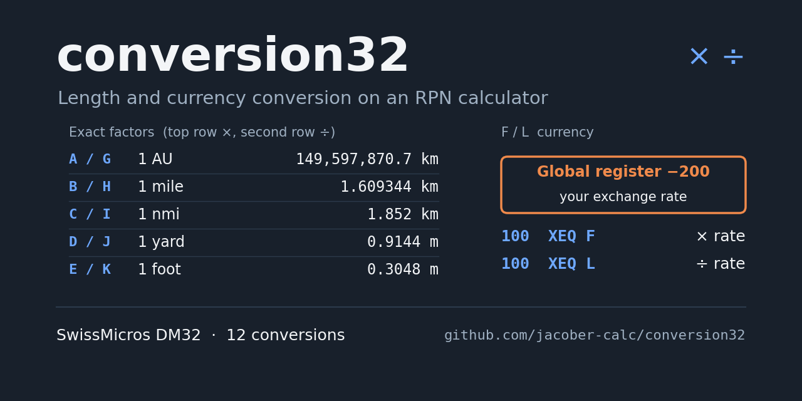
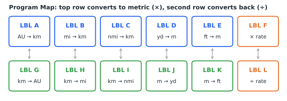
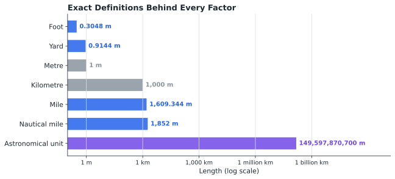
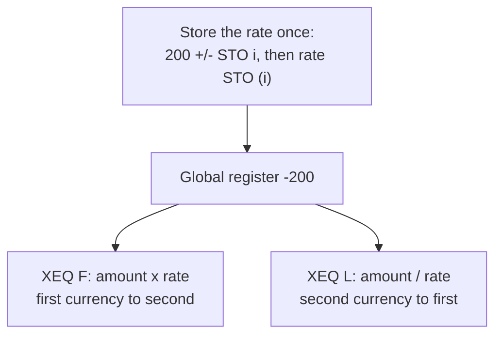
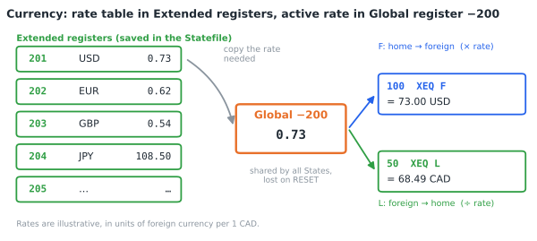
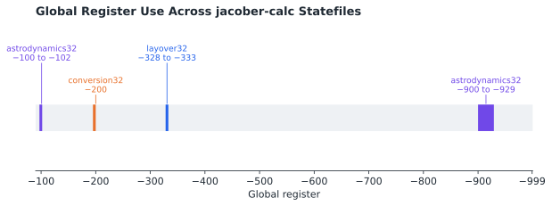

# conversion Statefile

## TABLE OF CONTENTS

1. [Introduction](#1-introduction)
2. [Theory of Operations](#2-theory-of-operations)
3. [Register Definitions](#3-register-definitions)
4. [Program Descriptions](#4-program-descriptions)
5. [Operating Instructions](#5-operating-instructions)
6. [Example Calculations](#6-example-calculations)
7. [Quick Reference](#7-quick-reference)
8. [Program Listing](#8-program-listing)

---

## 1. INTRODUCTION

This program suite provides one-key unit conversions for the SwissMicros DM32 calculator. Five pairs of programs convert between common imperial, nautical, and astronomical lengths and their metric equivalents, and a sixth pair converts between two currencies at an exchange rate the user stores.

### 1.1 Purpose

The program enables users to:

- Convert astronomical units, miles, nautical miles, yards, and feet to kilometres or metres, and back
- Convert an amount between two currencies at a stored exchange rate
- Keep a table of exchange rates for several currencies and switch between them

### 1.2 System Requirements

SwissMicros DM32 calculator with RPN operating system. Program requires 54 program steps in 12 labels. No flags, equations, or variables are used.

The length conversions (LBL A–E and G–K) use only functions found on the HP-32SII and can be keyed into one from the listing in section 8. The currency programs (LBL F and L) use a DM32 Global register, which the HP-32SII does not have.

### 1.3 Install and Download

Copy **CONVERSION.d32** to the `/STATE` folder of the DM32's internal USB disk, then load it from the calculator. Instructions are available [via the DM32 User Manual](https://technical.swissmicros.com/dm32/doc/dm32_user_manual.html#_saving_and_loading_a_state).

**Before using LBL F or LBL L, store an exchange rate in Global register −200** (section 5.2). The rate is not part of the Statefile.

---

## 2. THEORY OF OPERATIONS

### 2.1 Conversion Pairs

The programs are arranged in pairs that follow the DM32 keyboard. Each program in the top row (LBL A–F) multiplies by a factor; the program directly below it in the second row (LBL G–L) divides by the same factor and so reverses the conversion.



### 2.2 Exact Conversion Factors

Every length factor is an exact definition, not a measurement:

| Unit | Definition | Programs |
|------|------------|----------|
| Astronomical unit | 149,597,870.7 km (IAU, 2012) | A / G |
| International mile | 1.609344 km | B / H |
| Nautical mile | 1.852 km | C / I |
| International yard | 0.9144 m | D / J |
| International foot | 0.3048 m | E / K |

Because the factors are exact, a conversion and its reverse return the original value. LBL A–C and G–I work in kilometres; LBL D–E and J–K work in metres.



**Note:** LBL A uses 149,597,870 km per AU, while LBL G uses the full definition, 149,597,870.7 km. The difference is 0.7 km per AU, a relative error of about 5 × 10⁻⁹, so converting 1 AU to kilometres with LBL A and back with LBL G returns 0.999999995.

### 2.3 Currency Conversion and Global Register −200

Exchange rates change daily, so the currency programs do not contain a rate. Instead, LBL F and LBL L read it from **Global register −200**: LBL F multiplies the amount in the X register by the rate, and LBL L divides by it.



Store the rate as the number of units of the second currency equal to one unit of the first. LBL F then converts from the first currency to the second, and LBL L converts back. With a rate of 0.73 US dollars per Canadian dollar, for example, LBL F converts Canadian dollars to US dollars and LBL L converts US dollars to Canadian dollars.

### 2.4 Global and Extended Registers

The DM32 has two sets of 900 registers that can be reached only through the index register i:

| Registers | Index | Saved in the Statefile? | Shared between States? |
|-----------|-------|-------------------------|------------------------|
| Global | −100 to −999 | No: lost on RESET or firmware update | Yes |
| Extended | 100 to 999 | Yes | No |

A rate stored in Global register −200 is available in every State, so it can be set once and used from anywhere. It is not saved, however, and must be stored again after a RESET or firmware update. Extended registers are saved with the State, which makes them a good place to keep a permanent table of rates (section 5.4).



Global register −200 does not clash with the other jacober-calc Statefiles that use Global registers:



---

## 3. REGISTER DEFINITIONS

| Register | Description |
|----------|-------------|
| **i** | Index register; set to −200 by LBL F and LBL L |
| **Global −200** | Exchange rate used by LBL F and LBL L (stored by the user) |
| **Extended 201 and up** | Suggested location for a saved table of exchange rates (optional) |

No variables (A–Z) are used, so all 26 remain free.

---

## 4. PROGRAM DESCRIPTIONS

Every program takes a value in the X register and returns the converted value in the X register.

### 4.1 Length Conversions

| Label | Converts | Operation | Reverse |
|-------|----------|-----------|---------|
| **A** | Astronomical units to kilometres | × 149,597,870 | G |
| **B** | Miles to kilometres | × 1.609344 | H |
| **C** | Nautical miles to kilometres | × 1.852 | I |
| **D** | Yards to metres | × 0.9144 | J |
| **E** | Feet to metres | × 0.3048 | K |
| **G** | Kilometres to astronomical units | ÷ 149,597,870.7 | A |
| **H** | Kilometres to miles | ÷ 1.609344 | B |
| **I** | Kilometres to nautical miles | ÷ 1.852 | C |
| **J** | Metres to yards | ÷ 0.9144 | D |
| **K** | Metres to feet | ÷ 0.3048 | E |

### 4.2 Currency Conversions

#### LBL F - Multiply by Rate

- **Input:** Amount in the first currency (X register)
- **Output:** Amount in the second currency (X register)
- **Requires:** Exchange rate in Global register −200

#### LBL L - Divide by Rate

- **Input:** Amount in the second currency (X register)
- **Output:** Amount in the first currency (X register)
- **Requires:** Exchange rate in Global register −200

Both programs leave the index register i set to −200.

---

## 5. OPERATING INSTRUCTIONS

### 5.1 Length Conversions

**Procedure:**
```
1. Enter the value
2. Press [XEQ] and the program letter
```

**Result:** Converted value in the X register

### 5.2 Storing the Exchange Rate

Do this before the first currency conversion, after any RESET or firmware update, and whenever the rate changes.

**Procedure:**
```
1. Key in 200, press [+/-], then [STO] [i]    (point i at Global register -200)
2. Key in the exchange rate
3. Press [STO] [(i)]                          (store the rate)
```

**To check the stored rate:** `200` `[+/-]` `[STO] [i]` `[VIEW] [(i)]`

### 5.3 Converting Currency

**First currency to second:**
```
1. Enter the amount
2. Press [XEQ] [F]
```

**Second currency to first:**
```
1. Enter the amount
2. Press [XEQ] [L]
```

### 5.4 Loading Other Currencies

LBL F and LBL L always use whatever rate is in Global register −200, so any currency pair can be used by storing its rate there. There are two ways to manage several currencies.

**Method 1: Replace the rate.** For occasional use, store the new rate over the old one using the procedure in section 5.2.

**Method 2: Keep a rate table in Extended registers.** For regular use, store each rate once in its own Extended register, numbered from 201. Extended registers are saved with the State, so the table survives a RESET once the State has been saved.

To store a rate in the table (for example, EUR in register 202):
```
1. Key in 202, press [STO] [i]
2. Key in the rate
3. Press [STO] [(i)]
```

To make a currency from the table active (copy register 202 to Global -200):
```
1. Key in 202, press [STO] [i]
2. Press [RCL] [(i)]                          (the rate is now in X)
3. Key in 200, press [+/-], then [STO] [i]
4. Press [x<>y]                               (the rate is back in X)
5. Press [STO] [(i)]
```

Keep a written list of which currency is in each register, for example:

| Extended register | Currency | Rate (per 1 home unit) |
|-------------------|----------|------------------------|
| 201 | US dollar | 0.73 |
| 202 | Euro | 0.62 |
| 203 | Pound sterling | 0.54 |
| 204 | Japanese yen | 108.50 |

*Rates shown are illustrative only.*

**Tip:** Save the State after building or updating the table (see the DM32 User Manual) so the rates are written to the Statefile.

### 5.5 Restoring the Rate After a RESET

A RESET or firmware update clears all Global registers. Store the rate again with section 5.2, or copy it from the Extended-register table with section 5.4.

---

## 6. EXAMPLE CALCULATIONS

Results are shown in FIX 6, the display format saved in the Statefile.

### 6.1 Astronomical Units to Kilometres

**Problem:** How many kilometres is 1 AU?

**Solution:**
```
1 [XEQ] [A]
```

**Expected Result:** 149,597,870.000000 km (see the note in section 2.2)

### 6.2 Kilometres to Astronomical Units

**Problem:** The MOON's mean distance from the EARTH is 384,400 km. How many AU is that?

**Solution:**
```
384400 [XEQ] [G]
```

**Expected Result:** 0.002570 AU

### 6.3 Kilometres to Miles

**Problem:** A marathon is 42.195 km. How many miles is that?

**Solution:**
```
42.195 [XEQ] [H]
```

**Expected Result:** 26.218757 miles

### 6.4 Nautical Miles

**Problem:** Convert 100 nautical miles to kilometres, and 1,000 km to nautical miles.

**Solution:**
```
100 [XEQ] [C]
1000 [XEQ] [I]
```

**Expected Results:** 185.200000 km; 539.956803 nautical miles

### 6.5 Yards and Metres

**Problem:** Convert 100 yards to metres, and 100 metres to yards.

**Solution:**
```
100 [XEQ] [D]
100 [XEQ] [J]
```

**Expected Results:** 91.440000 m; 109.361330 yards

### 6.6 Feet and Metres

**Problem:** Mount Everest is often quoted as 29,029 ft; the 2020 survey gives 8,848.86 m. Convert each.

**Solution:**
```
29029 [XEQ] [E]
8848.86 [XEQ] [K]
```

**Expected Results:** 8,848.039200 m; 29,031.692913 ft

### 6.7 Chaining Conversions

**Problem:** How many feet are in a mile?

**Solution:**
```
1 [XEQ] [B]        (1.609344 km)
1000 [×]           (1,609.344 m)
[XEQ] [K]
```

**Expected Result:** 5,280.000000 ft

### 6.8 Currency Conversion

**Problem:** At an illustrative rate of 0.73 US dollars per Canadian dollar, convert 100 CAD to USD and 50 USD to CAD.

**Solution:**
```
200 [+/-] [STO] [i]
0.73 [STO] [(i)]          (store the rate)
100 [XEQ] [F]
50 [XEQ] [L]
```

**Expected Results:** 73.000000 USD; 68.493151 CAD

### 6.9 Switching Currency from the Rate Table

**Problem:** The rate table holds 0.62 euros per Canadian dollar in Extended register 202. Make it active and convert 100 CAD to EUR.

**Solution:**
```
202 [STO] [i]
0.62 [STO] [(i)]          (store EUR in the table; once only)
202 [STO] [i]
[RCL] [(i)]
200 [+/-] [STO] [i]
[x<>y] [STO] [(i)]        (copy EUR to Global -200)
100 [XEQ] [F]
```

**Expected Result:** 62.000000 EUR

---

## 7. QUICK REFERENCE

### 7.1 Program Summary

| Top row (×) | Factor | Second row (÷) |
|-------------|--------|----------------|
| **A** AU → km | 149,597,870 / 149,597,870.7 | **G** km → AU |
| **B** mi → km | 1.609344 | **H** km → mi |
| **C** nmi → km | 1.852 | **I** km → nmi |
| **D** yd → m | 0.9144 | **J** m → yd |
| **E** ft → m | 0.3048 | **K** m → ft |
| **F** × rate | Global −200 | **L** ÷ rate |

### 7.2 Currency Keystrokes

| Task | Keystrokes |
|------|------------|
| Store rate | `200 [+/-] [STO] [i]` then `rate [STO] [(i)]` |
| View rate | `200 [+/-] [STO] [i]` then `[VIEW] [(i)]` |
| Store in table | `20n [STO] [i]` then `rate [STO] [(i)]` |
| Copy from table | `20n [STO] [i] [RCL] [(i)] 200 [+/-] [STO] [i] [x<>y] [STO] [(i)]` |

### 7.3 Important Notes

- Store an exchange rate in Global register −200 before using LBL F or LBL L; if none is stored, the register reads 0, so LBL F returns 0 and LBL L stops with a divide-by-zero error
- Global registers are shared by all States but are not saved; they are cleared by RESET or a firmware update
- Extended registers are saved with the State and are the place for a permanent rate table
- Store rates as units of the second currency per one unit of the first
- LBL F and LBL L leave i set to −200
- Exchange rates in this document are illustrative; use current rates from a reliable source

---

## 8. PROGRAM LISTING

The complete program listing is provided below. Program steps are shown in standard DM32 RPN format with label-relative line numbers, as displayed on the calculator. The DM32 does not generate checksums.

### LBL A - Astronomical Units to Kilometres

```
A01  LBL A        Astronomical units to km.
A02  149597870    km per AU.
A03  ×
A04  RTN          Returns km in X.
```

### LBL G - Kilometres to Astronomical Units

```
G01  LBL G        km to astronomical units.
G02  149597870.7  km per AU.
G03  ÷
G04  RTN          Returns AU in X.
```

### LBL B - Miles to Kilometres

```
B01  LBL B        Miles to km.
B02  1.609344     km per mile.
B03  ×
B04  RTN          Returns km in X.
```

### LBL H - Kilometres to Miles

```
H01  LBL H        km to miles.
H02  1.609344     km per mile.
H03  ÷
H04  RTN          Returns miles in X.
```

### LBL C - Nautical Miles to Kilometres

```
C01  LBL C        Nautical miles to km.
C02  1.852        km per nautical mile.
C03  ×
C04  RTN          Returns km in X.
```

### LBL I - Kilometres to Nautical Miles

```
I01  LBL I        km to nautical miles.
I02  1.852        km per nautical mile.
I03  ÷
I04  RTN          Returns nmi in X.
```

### LBL D - Yards to Metres

```
D01  LBL D        Yards to metres.
D02  0.9144       Metres per yard.
D03  ×
D04  RTN          Returns metres in X.
```

### LBL J - Metres to Yards

```
J01  LBL J        Metres to yards.
J02  0.9144       Metres per yard.
J03  ÷
J04  RTN          Returns yards in X.
```

### LBL E - Feet to Metres

```
E01  LBL E        Feet to metres.
E02  0.3048       Metres per foot.
E03  ×
E04  RTN          Returns metres in X.
```

### LBL K - Metres to Feet

```
K01  LBL K        Metres to feet.
K02  0.3048       Metres per foot.
K03  ÷
K04  RTN          Returns feet in X.
```

### LBL F - Currency, Multiply by Rate

```
F01  LBL F        Currency: amount × rate.
F02  -200         Global register -200
F03  STO i        holds the rate.
F04  CLx          Clears the index
F05  RCL(i)       and recalls the rate.
F06  ×            Amount × rate.
F07  RTN          Returns converted amount.
```

### LBL L - Currency, Divide by Rate

```
L01  LBL L        Currency: amount ÷ rate.
L02  -200         Global register -200
L03  STO i        holds the rate.
L04  CLx          Clears the index
L05  RCL(i)       and recalls the rate.
L06  ÷            Amount ÷ rate.
L07  RTN          Returns converted amount.
```

---

## Disclaimer

This program suite is provided as-is for educational and personal use. Exchange rates must be supplied by the user; the program does not provide or update them.

### By jacober-calc for SwissMicros DM32

> - [SwissMicros Website](https://www.swissmicros.com)
> - [DM32 product page](https://www.swissmicros.com/en/products/dm32)
> - [SwissMicros full products page](https://www.swissmicros.com/en/shop)
> - [DM32 Online User Manual](https://technical.swissmicros.com/dm32/doc/dm32_user_manual.html)
> - [SwissMicros Calculator Forum](https://forum.swissmicros.com/index.php)
